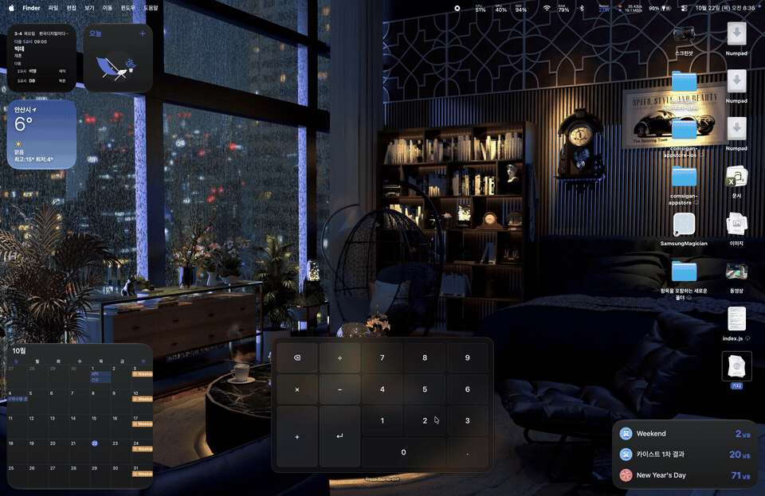

<p align="center">
  
</p>

<h1 align="center">Numpad</h1>

<p align="center">
  <strong>Your trackpad. A number pad.</strong><br>
  A native macOS menu bar app for the numbers your keyboard is missing.
</p>

<p align="center">
  <a href="https://github.com/yeonfish6040/Numpad/releases/latest"></a>
  
  
  
</p>

<p align="center">
  <a href="https://github.com/yeonfish6040/Numpad/releases/latest"><strong>Download for Mac ↓</strong></a>
  &nbsp; · &nbsp; <a href="#get-started">Get started</a>
  &nbsp; · &nbsp; <a href="docs/DEVELOPMENT.md">Build from source</a>
  &nbsp; · &nbsp; <a href="README.ko.md">한국어</a>
</p>

<p align="center">
  
</p>

By default, press <kbd>Right ⌘</kbd> + <kbd>Right ⌥</kbd>, tap a number, and keep going. Numpad turns the touch surface you already have into a numeric keypad, with an overlay to guide you and haptics you can feel.

## See it in action

[](https://github.com/yeonfish6040/Numpad/releases/download/v0.0.4/Numpad-demo.mp4)

[Watch the demo ↗](https://github.com/yeonfish6040/Numpad/releases/download/v0.0.4/Numpad-demo.mp4) · 36 seconds of typing and finger calibration, recorded on a Mac.

## A little more keyboard, without more hardware

| | |
| :--- | :--- |
| **Tap to type**<br>Numbers, decimal point, arithmetic operators, Return, and Backspace. A short tap types once when you lift your finger. | **Feel each input**<br>Separate haptics for touch down and confirmed input, plus a stronger guide at the center of `5`. |
| **Make room**<br>Drag the translucent overlay anywhere. Snap to screen edges or center; let it move around the focused input field. | **Pick your side**<br>Place operators on the left or right. Rest one finger and use another for repeated taps. |
| **Keep it local**<br>No accounts, network requests, analytics, or input log files. The app reads field geometry to position the overlay, not field contents. | **Choose your language**<br>English by default, with Korean and Japanese available in Settings. Switch instantly, without restarting. |

## Get started

1. **[Download the latest DMG](https://github.com/yeonfish6040/Numpad/releases/latest)**, open it, and drag **Numpad** into **Applications**. Release builds are Developer ID signed and notarized by Apple.
2. Open Numpad and allow it under **System Settings → Privacy & Security → Accessibility**. The app lives in your menu bar.
3. Focus a text field, then press and release <kbd>Right ⌘</kbd> + <kbd>Right ⌥</kbd> to turn the keypad on.
4. Tap the position of a key on your trackpad. Press <kbd>Esc</kbd> or the same shortcut to go back to normal.

**Requires macOS 13+ and a Mac trackpad.** Force Touch is required for haptic feedback. The DMG includes Apple Silicon and Intel support.

On first launch, an interactive guide walks through permission, layout, the shortcut, and a safe typing practice. Reopen it anytime from **Getting Started…** in the menu bar. English, Korean, and Japanese can be selected inside the guide.

> While the keypad is on, pointer movement, tap-to-click, scrolling, and gestures from selected trackpads are blocked when their source can be identified. Physical clicks and click-drag still work. Other trackpads and mice keep working normally. Opening Settings turns the keypad off.

## Settle into your layout

Choose **Settings → Keyboard** to record an activation shortcut or reset it to Right Command + Right Option. Press and release either two or more modifier keys (with left/right sides remembered), or a key with Command, Option, or Control. Escape stays reserved for turning the keypad off. The recorder checks enabled macOS shortcuts and registered global hotkeys, rejects detected conflicts, and keeps your previous shortcut until a valid replacement is recorded. Some app-internal shortcuts and modifier-only shortcuts cannot be checked for conflicts.

In the same tab, choose the left or right operator layout and select two keys to swap their positions. Slot sizes stay fixed, including the wide bottom key and tall side keys. Each side remembers its own arrangement, and the overlay and touch input update together.

Choose **Settings → Trackpads** to select which connected trackpads act as keypads. You can select several at once; taps, calibration, and haptics are tracked per device. Unselected trackpads retain normal pointer movement, clicks, scrolling, and gestures. New devices start unselected. Connecting or disconnecting a trackpad safely turns the keypad off; press your shortcut to resume with the current selection.

Choose **Settings → General → Launch at Login** to start Numpad in the menu bar when you log in. It starts with the keypad off. If macOS requires approval, use **Open Login Items Settings** to allow it. Turn the switch off to remove the login item.

Choose **Settings → General** to change the language. Drag the overlay to save its location, or use **Reset to Bottom Center** to start fresh.

Choose **Settings → Haptics** to decide which interactions you want to feel.

<p align="center">
  
  &nbsp;
  
</p>

<details>
<summary><strong>Experimental: fit the keypad to your fingers</strong></summary>

Enable **Settings → Experimental → Calibrate with Finger Positions** to move, rotate, and scale the layout with three fingers. The middle finger anchors `5`; the outer fingers set the angle and scale.

Optional four-finger calibration aligns the middle two fingers with `×` and `−`. Calibration is saved separately for left and right operator layouts, and can be kept between sessions or reset at any time. It is off by default.

Calibration filters identifiable events from selected trackpads. It does not change system-wide zoom settings. Calibration is saved per trackpad and key arrangement. Large adjustments can move keys beyond the trackpad area.

<p align="center">
  
</p>

</details>

## Good to know

<details>
<summary><strong>Why is the shortcut not working?</strong></summary>

With the default shortcut, use the **right-hand** Command and Option keys, without Shift or Control. Check your shortcut in **Settings → Keyboard**, select at least one trackpad in **Trackpads**, and check Accessibility permission and the menu bar icon. Secure Input, sleep, permission loss, or a stopped input monitor turns keypad mode off.

</details>

<details>
<summary><strong>Can I rest a finger on the trackpad?</strong></summary>

Yes. A stationary finger becomes an anchor after about 120 ms, letting another finger tap repeatedly. The anchor does not type. Lifting it or moving it too far cancels the current tap. A single-finger tap on `5` still types normally.

</details>

<details>
<summary><strong>What should I know about compatibility?</strong></summary>

Numpad uses private Apple APIs for trackpad input, some haptics, and device attribution. Compatibility may change with macOS updates. Connected trackpads refresh automatically; changing connections turns keypad mode off safely. Device selection persists using a hardware serial number when available, with a device-ID fallback. A device whose identifier changes may need to be selected again.

Physical clicks and tap-to-click on selected trackpads are distinguished using pressure. Events with unknown or synthetic device origins pass through unchanged to avoid blocking other devices. Some system gestures or accessibility zoom may therefore still take effect when macOS does not expose their source. Decimal input and keypad shortcuts follow the receiving app and input settings.

</details>

## Build, explore, contribute

```sh
git clone https://github.com/yeonfish6040/Numpad.git
cd Numpad
swift test
bash scripts/build-app.sh
open dist/Numpad.app
```

Built with Swift, AppKit, and SwiftUI, with no external package dependencies. The [development guide](docs/DEVELOPMENT.md) covers the codebase, localization, diagnostics, and signed DMG builds.

Found a bug or have an idea? [Open an issue](https://github.com/yeonfish6040/Numpad/issues) with your Mac model, macOS version, and steps to reproduce it. Translation improvements are welcome too. Thanks to [LumaKernel](https://github.com/LumaKernel) for contributing the Japanese localization.

## License

Numpad is source-available under the [Numpad Noncommercial Share-Alike License 1.0](LICENSE), a custom license. Noncommercial use, modification, redistribution, and pull requests are welcome. Commercial use requires separate written permission. If you redistribute the app or a modified version, you must provide the complete corresponding source code under the same license, retain notices, and identify your changes.

Because commercial use is restricted, this is not an OSI-approved open-source license. See [LICENSE](LICENSE) for the full terms.
